# 📱 Manual del Usuario: Aplicación Móvil de Preventas

Bienvenido al **Manual del Usuario** de la aplicación móvil de **Preventas**. Esta guía proporciona instrucciones detalladas para la operación en terreno por parte de preventistas y supervisores comerciales, tanto en modalidad conectada (**Online**) como en zonas sin cobertura o ante caídas del servidor (**Offline**).

---

## 📑 Tabla de Contenidos
1. [Acceso al Sistema (Login)](#1-acceso-al-sistema-login)
   - [1.1. Ingreso con Usuario y Contraseña (Online)](#11-ingreso-con-usuario-y-contraseña-online)
   - [1.2. Ingreso en Modo Fuera de Línea (Offline)](#12-ingreso-en-modo-fuera-de-línea-offline)
   - [1.3. Pantalla de Autenticación Biométrica](#13-pantalla-de-autenticación-biométrica)
2. [Barra Superior y Menú de Navegación](#2-barra-superior-y-menú-de-navegación)
   - [2.1. Indicador de Conectividad](#21-indicador-de-conectividad)
   - [2.2. Menú Lateral (Drawer)](#22-menú-lateral-drawer)
3. [Módulo "Mis Pedidos"](#3-módulo-mis-pedidos)
   - [3.1. Listado y Filtros por Estado](#31-listado-y-filtros-por-estado)
   - [3.2. Formato de Fechas y Zona Horaria](#32-formato-de-fechas-y-zona-horaria)
   - [3.3. Badges Comerciales y de Sincronización](#33-badges-comerciales-y-de-sincronización)
   - [3.4. Detalle del Pedido](#34-detalle-del-pedido)
4. [Módulo "Nuevo Pedido" (Wizard de Venta)](#4-módulo-nuevo-pedido-wizard-de-venta)
   - [4.1. Paso 1: Selección de Cliente y Venta](#41-paso-1-selección-de-cliente-y-venta)
   - [4.2. Paso 2: Carga de Artículos y Montos](#42-paso-2-carga-de-artículos-y-montos)
   - [4.3. Paso 3: Reparto y Confirmación](#43-paso-3-reparto-y-confirmación)
5. [Módulo "Catálogo de Productos"](#5-módulo-catálogo-de-productos)
   - [5.1. Búsqueda y Filtros por Categoría](#51-búsqueda-y-filtros-por-categoría)
   - [5.2. Visualización de Productos, Precios e Imágenes](#52-visualización-de-productos-precios-e-imágenes)
6. [Módulo "Mis Clientes"](#6-módulo-mis-clientes)
   - [6.1. Directorio y Búsqueda de Clientes](#61-directorio-y-búsqueda-de-clientes)
   - [6.2. Ficha de Detalle del Cliente](#62-ficha-de-detalle-del-cliente)
7. [Módulo "Mis Repartos"](#7-módulo-mis-repartos)
8. [Módulo "Faltantes" (Productos Pendientes de Entrega)](#8-módulo-faltantes-productos-pendientes-de-entrega)
9. [Sincronización Automática Offline](#9-sincronización-automática-offline)
10. [Cierre de Sesión y Resguardo de Información](#10-cierre-de-sesión-y-resguardo-de-información)

---

## 1. Acceso al Sistema (Login)

La pantalla de acceso cuenta con la identidad institucional circular de **San Luis Cloud** y gestiona el acceso mediante token JWT y mecanismos seguros de contingencia local.

### 1.1. Ingreso con Usuario y Contraseña (Online)
Cuando la aplicación cuenta con conexión al servidor central:
1. Si la organización está preconfigurada en el sistema (ejemplo: `CTRO`), el campo "Organización" permanece oculto automáticamente. En caso contrario, ingrese el código de organización.
2. Ingrese su **Usuario** asignado.
3. Ingrese su **Contraseña**.
4. Presione el botón **Conectar**.
5. Al autenticar exitosamente, se almacena de forma cifrada el token de sesión (con validez estándar de 8 horas) y un hash seguro de sus credenciales para habilitar posteriores accesos sin conexión.

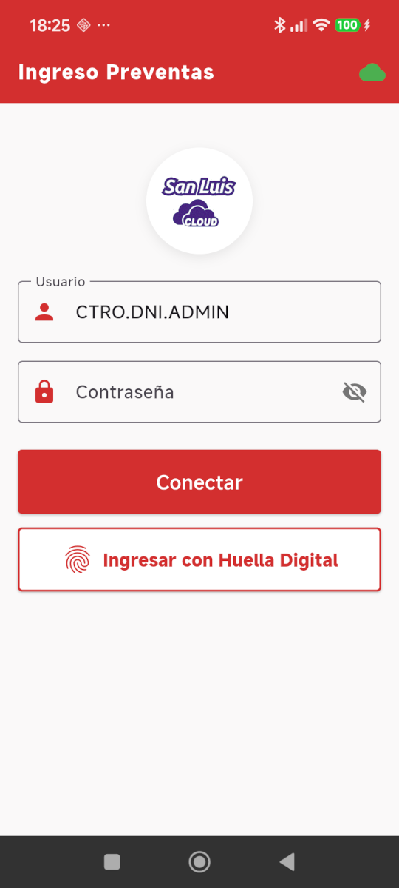

### 1.2. Ingreso en Modo Fuera de Línea (Offline)
Si el dispositivo pierde señal de red o si el servidor backend no responde (error 5xx o tiempo de espera agotado), la aplicación activa de forma inmediata y automática el **Modo Offline**:
- Se despliega un banner superior de advertencia: *"No hay conexión con el servidor. Se activó el modo offline."*
- Se habilitan dos botones de acceso rápido alternativos:
  - **Ingresar con Huella Digital:** Acceso biométrico instantáneo.
  - **Sesión Guardada:** Reingreso directo si existe una sesión previa válida en el terminal.
- También es posible ingresar digitando el usuario y contraseña habituales; el sistema validará localmente el hash criptográfico guardado en el dispositivo.

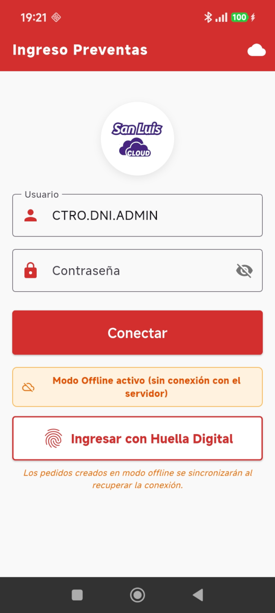

### 1.3. Pantalla de Autenticación Biométrica
Al pulsar sobre el botón de huella digital:
1. Se abre la pantalla interactiva de lectura biométrica.
2. Apoye su dedo sobre el sensor de huellas de su teléfono móvil.
3. Al detectarse la coincidencia, el círculo se ilumina en color verde y la aplicación ingresa de inmediato a la pantalla principal en modo offline.

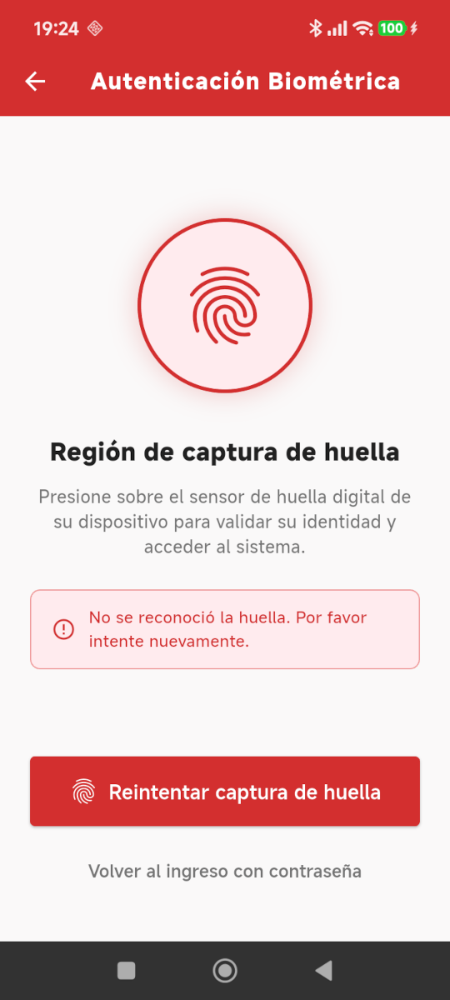

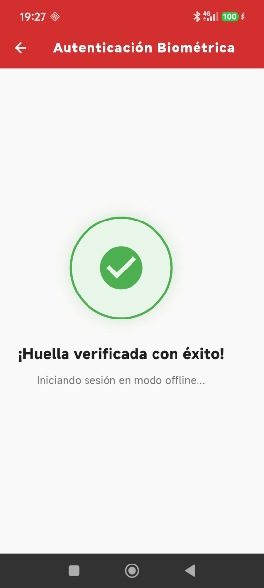

---

## 2. Barra Superior y Menú de Navegación

### 2.1. Indicador de Conectividad
En la cabecera roja institucional de todas las pantallas principales se muestra el estado de enlace con el servidor:
- 🟢 **Nube Verde:** Dispositivo en línea y conectado con Oracle ORDS. Todas las operaciones se transmiten inmediatamente.
- ⚪ **Nube Blanca / Gris:** Dispositivo fuera de línea o servidor inalcanzable. Las operaciones se almacenan localmente en memoria segura (Hive).

### 2.2. Menú Lateral (Drawer)
Al presionar el botón de menú hamburguesa (tres líneas) en la esquina superior izquierda, se despliega el menú lateral de opciones comerciales:
- **Mis Pedidos:** Tablero general de órdenes de venta.
- **Catálogo:** Consulta completa de artículos, listas de precios y fotos.
- **Clientes:** Directorio de clientes asignados y altas.
- **Repartos:** Rutas y turnos de entrega.
- **Faltantes:** Reporte de productos pendientes de despacho.
- **Cerrar Sesión:** Salida segura del sistema.

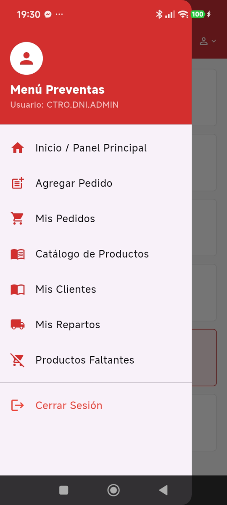

---

## 3. Módulo "Mis Pedidos"

### 3.1. Listado y Filtros por Estado
Permite visualizar la totalidad de los pedidos tomados por el preventista:
- **Barra de Búsqueda:** Búsqueda en tiempo real por nombre de cliente, código de pedido o fecha.
- **Pestañas de Filtrado:**
  - **Todos:** Muestra el historial completo de pedidos.
  - **Nuevos:** Pedidos recientemente registrados pendientes de facturar/repartir.
  - **Pendientes:** Pedidos en proceso de entrega o preparación.
  - **Finalizados:** Pedidos entregados y concluidos.

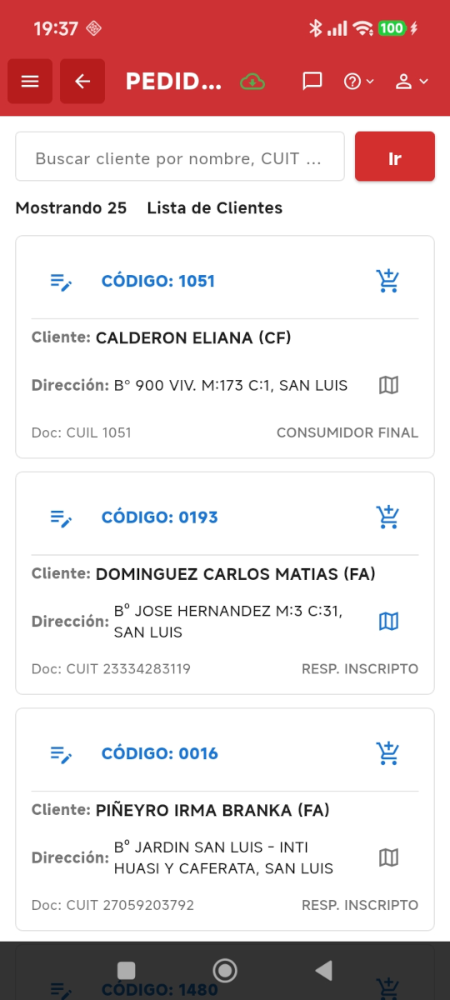

### 3.2. Formato de Fechas y Zona Horaria
Todas las órdenes de venta presentan un formato estandarizado y legible:  
`DD MON YYYY HH24:MI:SS` (ejemplo: `26 SEP 2026 16:30:15`), adaptado a la **hora local de Argentina (UTC-3)**.

### 3.3. Badges Comerciales y de Sincronización
Cada tarjeta de pedido cuenta con dos distintivos:
1. **Badge Comercial:** Indica el estado de la venta (`NUEVO`, `PENDIENTE`, `FINALIZADO`).
2. **Badge de Sincronización:**
   - 🟢 **ONLINE / SYNCED:** Pedido registrado en la base de datos central de Oracle.
   - 🟠 **OFFLINE / PENDING_SYNC:** Pedido tomado sin conexión; permanece resguardado en la base de datos local del teléfono.

### 3.4. Detalle del Pedido
Al tocar sobre cualquier tarjeta de pedido de la lista, se accede al desglose completo: cliente, condición de pago, zona de reparto, fecha y hora de emisión, lista de productos con precio unitario y cantidad, subtotal y total general.

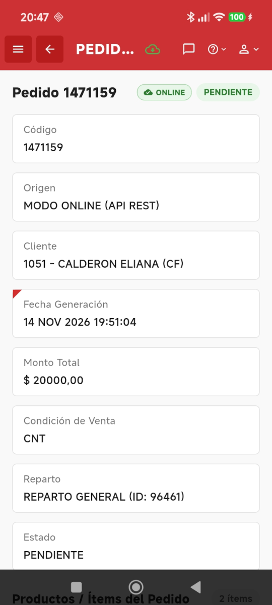

---

## 4. Módulo "Nuevo Pedido" (Wizard de Venta)

La generación de pedidos se ejecuta mediante un asistente de 3 pasos para minimizar errores de carga:

### 4.1. Paso 1: Selección de Cliente y Venta
1. Seleccione el cliente buscando por nombre, código o razón social.
2. Indique la condición de venta (**Contado** o **Cuenta Corriente**).
3. Presione el botón **Siguiente**.

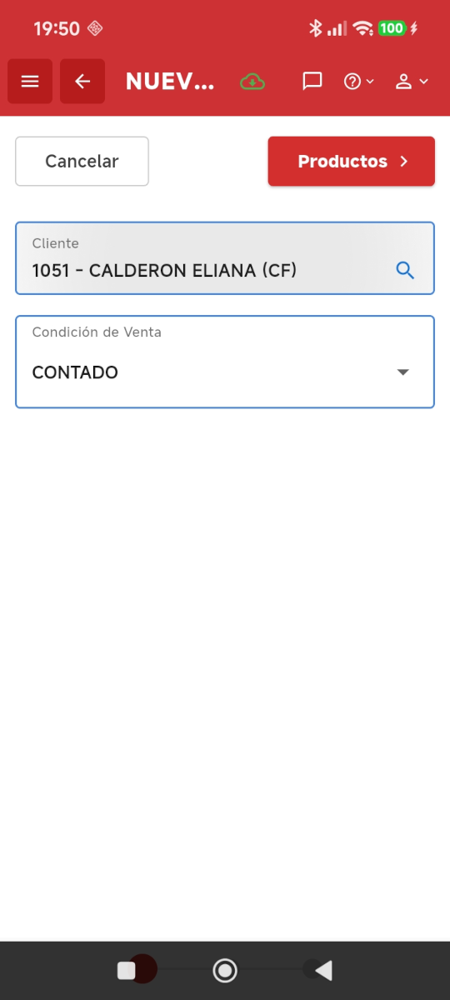

### 4.2. Paso 2: Carga de Artículos y Montos
1. Presione sobre el campo de producto para abrir la ventana emergente de búsqueda rápida en el catálogo.
2. Ingrese la cantidad deseada. Los subtotales e impuestos se calculan de manera automática.
3. Puede ajustar cantidades directamente con los botones `+` / `-` o eliminar renglones si fuera necesario.
4. Una vez completada la lista, presione **Siguiente**.

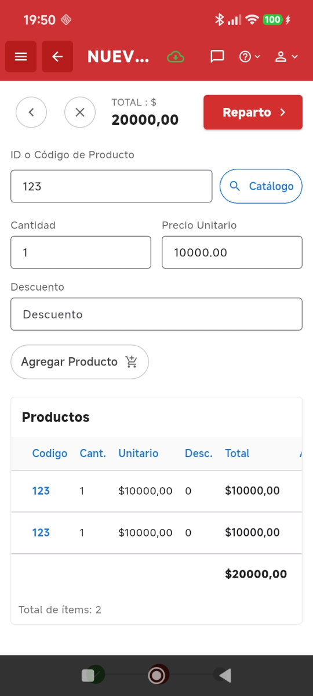

### 4.3. Paso 3: Reparto y Confirmación
1. Seleccione la zona o turno de reparto asignado para la entrega.
2. Verifique el importe total general y pulse **Confirmar**.
3. Si hay conexión a Internet, el pedido se enviará al servidor central; si se encuentra en zona sin señal, se guardará localmente con distintivo **OFFLINE** para su posterior sincronización.

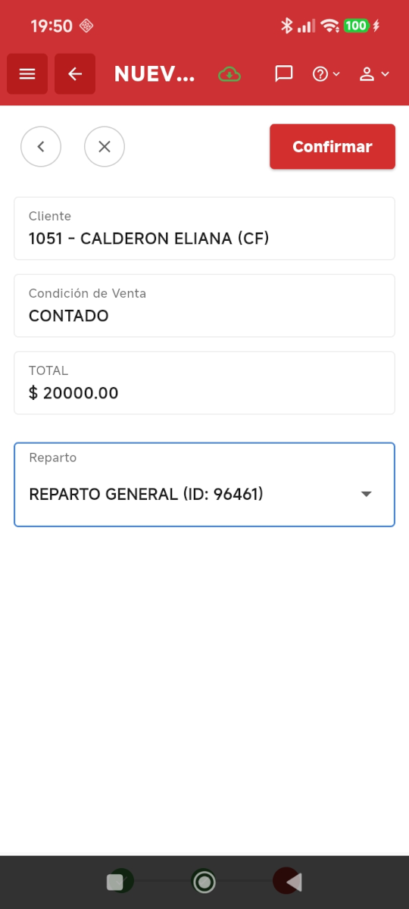

---

## 5. Módulo "Catálogo de Productos"

### 5.1. Búsqueda y Filtros por Categoría
Permite consultar la lista oficial de artículos comercializables:
- **Buscador interactivo:** Permite filtrar por código de artículo o descripción con el botón **Ir**.
- **Chips de Categoría:** Filtros superiores rápidos por rubro (ej: *Pastas*, *Panificación*, *Servicios*), mostrando el contador de productos disponibles por categoría.

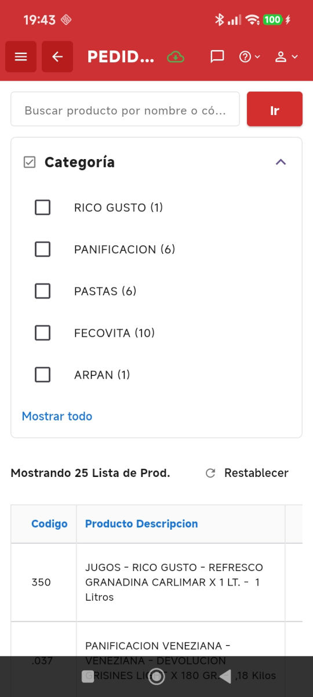

### 5.2. Visualización de Productos, Precios e Imágenes
- Cada fila o tarjeta presenta: Código del artículo, Descripción completa, Precio Unitario y fotografía/miniatura del producto.
- En caso de cortes transitorios del servidor, la pantalla presenta un mensaje de contingencia en español con la opción de **Reintentar** sin bloquear la navegación.

---

## 6. Módulo "Mis Clientes"

### 6.1. Directorio y Búsqueda de Clientes
- **Cartera de Clientes:** Visualiza el listado comercial asignado al preventista.
- **Buscador Integrado:** Permite localizar cuentas por razón social, nombre de fantasía o número de CUIT/DNI.
- **Acciones Rápidas por Tarjeta de Cliente:**
  - 🛒 **Icono de Carrito (`add_shopping_cart`):** Inicia de forma inmediata el Asistente de Creación de Pedido con el cliente actual preseleccionado en el Paso 1.
  - 🗺️ **Icono de Mapa Desplegado (`map_outlined`):** Abre la ventana emergente de georreferencia para visualizar la ubicación geográfica, dirección comercial y coordenadas del cliente sobre el mapa.
  - 📝 **Icono de Detalle (`edit_note`):** Accede a la ficha técnica completa del cliente.
- **Registro en Terreno:** Incluye el botón **Crear** para dar de alta nuevas cuentas directamente desde la ruta.

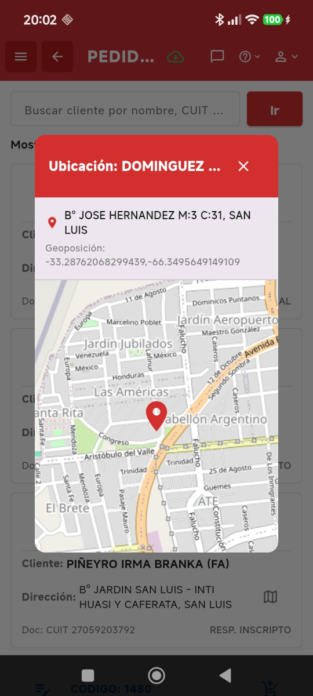

### 6.2. Ficha de Detalle del Cliente
Al pulsar sobre un cliente se accede a su ficha técnica estructurada en cajas de información:
- Nombre y Razón Social.
- Tipo y Número de Documento (CUIT/DNI).
- Condición de IVA (Responsable Inscripto, Monotributo, Consumidor Final).
- Teléfonos y correos electrónicos de contacto.
- Dirección comercial y estado de la cuenta.

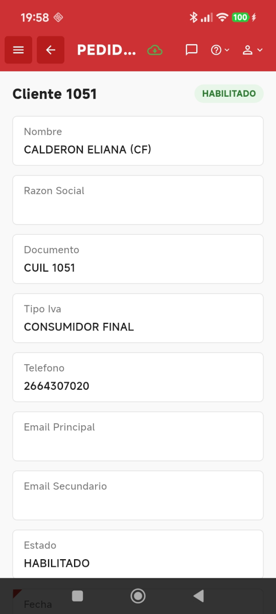

---

## 7. Módulo "Mis Repartos"

Permite al preventista y al transportista consultar las rutas y viajes programados:
- Filtros por estado del viaje (**Todos**, **En Curso**, **Programados**, **Finalizados**).
- Tarjetas con información del reparto: Código identificador, Fecha de despacho, Zona asignada, Nombre del chofer y Descripción de la ruta.

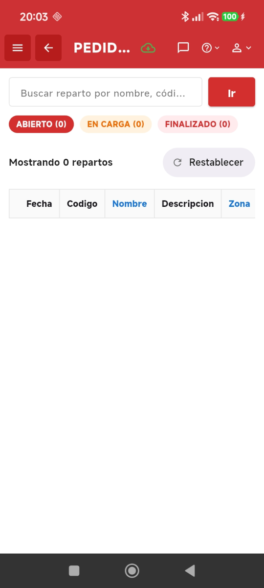

---

## 8. Módulo "Faltantes" (Productos Pendientes de Entrega)

Diseñado para registrar y controlar artículos que no pudieron ser entregados en destino:
- Buscador con botón **Ir** para ubicar pedidos o artículos específicos.
- Tabla estructurada con: Código del producto, Descripción, Observación del motivo de no entrega (ej: *Sin stock en depósito*, *Local cerrado*) y fecha/hora relativa del reporte (*"hace 2 horas"*, *"ayer"*).

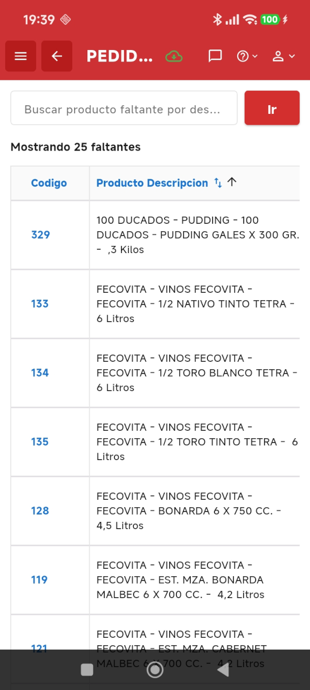

---

## 9. Sincronización Automática Offline

El sistema opera con arquitectura **Offline-First**:
1. **Detección Automática:** Tan pronto el teléfono recupera señal de red (Wi-Fi o datos móviles), el servicio de fondo detecta los pedidos en estado `PENDING_SYNC`.
2. **Transmisión y Notificación:** Los pedidos se envían en bloque al servidor de Oracle APEX/ORDS. Al completarse, se despliega una notificación emergente indicando la cantidad de pedidos sincronizados con éxito.
3. **Actualización de Distintivos:** Los estados de los pedidos pasan de `OFFLINE` a `ONLINE` de forma transparente.
4. **Retención de Datos:** Los pedidos sincronizados se preservan en la memoria local durante 30 días para consultas rápidas sin consumo de datos.

---

## 10. Cierre de Sesión y Resguardo de Información

- **Cierre Seguro:** Desde el menú lateral seleccione **Cerrar Sesión** cuando deba entregar el terminal a otro preventista.
- **Protección de Datos Locales:** El cierre de sesión o reinicio del teléfono nunca elimina los pedidos tomados offline que estén pendientes de sincronización.
